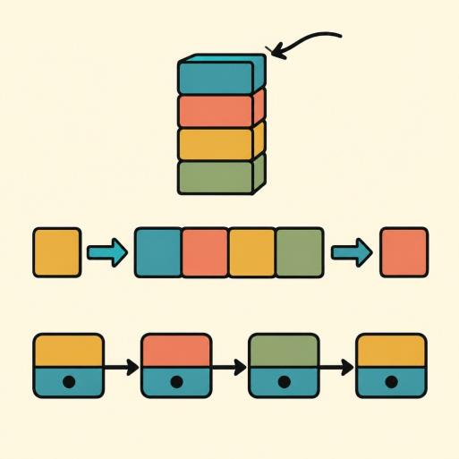
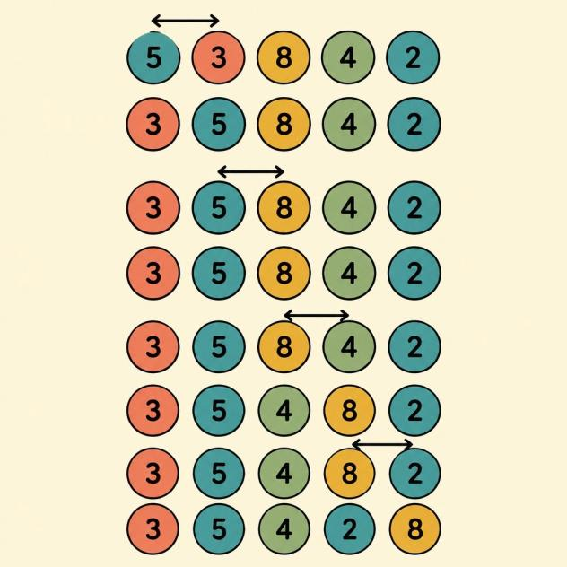

# Unidad 2: Estructuras de Datos Básicas en Java

**Nombre:** Cristopher Gerardo Villanueva Ramirez  
**Fecha:** 13 de Noviembre del 2026  
**Clase:** Estructura de Datos

📄 Documento original en Word: [Unidad_2_Estructuras_de_Datos_Basicas_en_Java.docx](Unidad_2_Estructuras_de_Datos_Basicas_en_Java.docx)

## Códigos del repositorio

| Archivo | Tema |
|---|---|
| [PilaCaracteres.java](codigos/PilaCaracteres.java) | Pila para revertir una cadena |
| [ColaImpresion.java](codigos/ColaImpresion.java) | Cola para una fila de impresión |
| [HistorialNavegacion.java](codigos/HistorialNavegacion.java) | Lista para un historial de navegación |
| [Ordenamiento.java](codigos/Ordenamiento.java) | Bubble Sort y QuickSort |
| [Busqueda.java](codigos/Busqueda.java) | Búsqueda lineal y binaria |

Para ejecutar cualquiera:

```
cd codigos
javac PilaCaracteres.java
java PilaCaracteres
```

---

# 1. Estructuras de Datos Lineales: Listas, Pilas y Colas

> **Conceptos Clave**
> - **Pila (Stack)** — estructura LIFO (Last In, First Out): el último elemento en entrar es el primero en salir. Operaciones: `push` (apilar) y `pop` (desapilar).
> - **Cola (Queue)** — estructura FIFO (First In, First Out): el primer elemento en entrar es el primero en salir. Operaciones: `enqueue` (encolar) y `dequeue` (desencolar).
> - **Lista Enlazada** — secuencia de nodos donde cada nodo guarda un dato y una referencia al siguiente. Operaciones: `add` (insertar) y `remove` (eliminar).



Imagina tres escenas cotidianas: una pila de platos donde solo puedes tomar el de arriba, una fila del banco donde el primero en llegar es el primero en ser atendido, y una lista de reproducción donde puedes saltar a cualquier canción. Cada escena es una estructura de datos lineal.

Una **pila** solo permite trabajar por un extremo, llamado tope. Cuando apilas con `push`, el nuevo elemento queda encima de todos; cuando desapilas con `pop`, sale siempre el último que entró. Ese orden se conoce como **LIFO**.

Una **cola** trabaja por los dos extremos: los elementos entran por atrás con `enqueue` y salen por el frente con `dequeue`. El primero en llegar es el primero en salir: **FIFO**.

Una **lista enlazada** guarda sus elementos en nodos conectados por referencias. Puedes insertar con `add` o eliminar con `remove` en cualquier posición recorriendo los nodos desde el inicio.

## Caso 1: Una Pila para revertir una cadena de texto

**Implementación de `push` y `pop`:**

```java
public void push(char c) {
    tope++;
    pila[tope] = c;
}

public char pop() {
    char c = pila[tope];
    tope--;
    return c;
}
```

**Paso a paso de `revertir("HOLA")`:**
- push(H), push(O), push(L), push(A) → la A queda arriba.
- pop sale A, luego L, luego O, luego H.
- Resultado: **"ALOH"**. Sale al revés porque el último en entrar es el primero en salir (LIFO).

## Caso 2: Una Cola para gestionar una fila de impresión

**Implementación de `enqueue` y `dequeue`:**

```java
public void encolar(String doc) {
    fin++;
    documentos[fin] = doc;
}

public String desencolar() {
    String doc = documentos[frente];
    frente++;
    return doc;
}
```

**Paso a paso con "Tarea", "Examen", "Boleta":**
- enqueue("Tarea") → cola: [Tarea]. Frente: Tarea.
- enqueue("Examen") → cola: [Tarea, Examen]. Frente: Tarea.
- enqueue("Boleta") → cola: [Tarea, Examen, Boleta]. Frente: Tarea.
- dequeue → imprime "Tarea". Frente: Examen.
- dequeue → imprime "Examen". Frente: Boleta.
- dequeue → imprime "Boleta". La cola queda vacía. Salen en el mismo orden en que llegaron (FIFO).

## Caso 3: Una Lista para un historial de navegación

**Implementación de `add` y `remove`:**

```java
public void add(String url) {
    paginas[tamanio] = url;
    tamanio++;
}

public void remove(String url) {
    for (int i = 0; i < tamanio; i++) {
        if (paginas[i].equals(url)) {
            for (int j = i; j < tamanio - 1; j++) {
                paginas[j] = paginas[j + 1];
            }
            paginas[tamanio - 1] = null;
            tamanio--;
            return;
        }
    }
}
```

**Paso a paso:**
- add("escuela.edu") → [escuela.edu]
- add("biblioteca.org") → [escuela.edu, biblioteca.org]
- add("noticias.com") → [escuela.edu, biblioteca.org, noticias.com]
- remove("biblioteca.org") → la busca, la quita y recorre noticias.com un lugar a la izquierda → [escuela.edu, noticias.com]

La lista sí puede borrar en medio porque permite entrar a cualquier posición. La pila solo trabaja por arriba y la cola solo por el frente.

## Para recordar

| Estructura | Principio | Operaciones | Caso práctico |
|---|---|---|---|
| Pila | LIFO (último en entrar, primero en salir) | push / pop | Revertir una cadena |
| Cola | FIFO (primero en entrar, primero en salir) | enqueue / dequeue | Fila de impresión |
| Lista Enlazada | Nodos en orden, acceso a cualquier posición | add / remove | Historial de navegación |

---

# 2. Algoritmos de Ordenamiento por Etapas

> **Conceptos clave**
> - **Bubble Sort** — recorre el arreglo comparando vecinos y los intercambia si están en el orden incorrecto. En cada pasada, el valor más grande "burbujea" hasta su posición final.
> - **QuickSort** — elige un **pivote**, divide el arreglo en menores y mayores que el pivote y repite el proceso en cada parte.
> - **Pasada (iteración)** — una vuelta completa del algoritmo sobre el arreglo.
> - **Intercambio (swap)** — mover un valor de una posición a otra usando una variable temporal.



Arreglo de trabajo: **[42, 7, 19, 3, 25, 8, 15, 30]**

## Parte 1 — Traza visual del Bubble Sort

| Pasada | Estado del arreglo al terminar la pasada | Intercambios |
|---|---|---|
| Inicio | [42, 7, 19, 3, 25, 8, 15, 30] | — |
| 1 | [7, 19, 3, 25, 8, 15, 30, 42] | 7 |
| 2 | [7, 3, 19, 8, 15, 25, 30, 42] | 3 |
| 3 | [3, 7, 8, 15, 19, 25, 30, 42] | 3 |
| 4 | [3, 7, 8, 15, 19, 25, 30, 42] | 0 |
| 5 | [3, 7, 8, 15, 19, 25, 30, 42] | 0 |
| 6 | [3, 7, 8, 15, 19, 25, 30, 42] | 0 |
| 7 | [3, 7, 8, 15, 19, 25, 30, 42] | 0 |

**1. ¿En qué pasada quedó ordenado?** En la pasada 3. Se nota porque en la pasada 4 ya no hubo ningún intercambio.

## Parte 2 — Primera partición de QuickSort (pivote 30)

2. **Menores que el pivote (izquierda):** 7, 19, 3, 25, 8, 15
3. **Mayores que el pivote (derecha):** 42
4. **Posición final del pivote 30:** índice 6
5. **Arreglo después de la partición:** [7, 19, 3, 25, 8, 15, 30, 42]
6. **Siguiente paso:** se hace lo mismo con la parte izquierda: se toma el 15 como nuevo pivote y se separa en menores y mayores. Se repite hasta que cada parte tenga 1 o 0 elementos. La parte derecha [42] ya está lista.

## Parte 3 — Implementación en Java

**7. Bubble Sort:**

```java
public static void ordenar(int[] arr) {
    for (int i = 0; i < arr.length - 1; i++) {
        for (int j = 0; j < arr.length - 1 - i; j++) {
            if (arr[j] > arr[j + 1]) {
                int temp = arr[j];
                arr[j] = arr[j + 1];
                arr[j + 1] = temp;
            }
        }
    }
}
```

**8. Traza de la primera pasada:**

| i | j | Estado del arreglo |
|---|---|---|
| 0 | 0 | [7, 42, 19, 3, 25, 8, 15, 30] |
| 0 | 1 | [7, 19, 42, 3, 25, 8, 15, 30] |
| 0 | 2 | [7, 19, 3, 42, 25, 8, 15, 30] |
| 0 | 3 | [7, 19, 3, 25, 42, 8, 15, 30] |
| 0 | 4 | [7, 19, 3, 25, 8, 42, 15, 30] |
| 0 | 5 | [7, 19, 3, 25, 8, 15, 42, 30] |
| 0 | 6 | [7, 19, 3, 25, 8, 15, 30, 42] |

**9.** El 42 es el número más grande y ya llegó al final, así que ningún otro es mayor para moverlo. Al terminar cada pasada, el mayor que falta queda en su lugar final; por eso cada pasada revisa una posición menos.

**10. Partición de QuickSort:**

```java
public static int particion(int[] arr, int inicio, int fin) {
    int pivote = arr[fin];
    int i = inicio - 1;
    for (int j = inicio; j < fin; j++) {
        if (arr[j] <= pivote) {
            i++;
            int temp = arr[i];
            arr[i] = arr[j];
            arr[j] = temp;
        }
    }
    int temp = arr[i + 1];
    arr[i + 1] = arr[fin];
    arr[fin] = temp;
    return i + 1;
}
```

**11.** Bubble Sort hizo 28 comparaciones (7+6+5+4+3+2+1) y QuickSort unas 16. Escala mejor QuickSort: con 1,000 elementos Bubble Sort haría cerca de 500,000 comparaciones (O(n²)) y QuickSort unas 10,000 (O(n log n)), porque va partiendo el problema en pedazos más chicos.

---

# 3. Búsqueda Lineal y Búsqueda Binaria

> **Conceptos clave**
> - **Búsqueda lineal** — recorre el arreglo uno por uno. Funciona en cualquier arreglo, ordenado o no.
> - **Búsqueda binaria** — compara con el valor del medio y descarta la mitad en cada paso. **Solo funciona si el arreglo está ordenado.**
> - **Big O** — O(n): trabajo proporcional al tamaño; O(log n): cada paso reduce el problema a la mitad.

**Caso práctico:** buscar el ID **68** en:

| índice | 0 | 1 | 2 | 3 | 4 | 5 | 6 | 7 |
|---|---|---|---|---|---|---|---|---|
| valor | 7 | 13 | 21 | 34 | 42 | 55 | 68 | 79 |

## Etapa 1: Simulación de la búsqueda binaria

| Iteración | inicio | fin | medio | valor en medio | decisión |
|---|---|---|---|---|---|
| 1 | 0 | 7 | 3 | 34 | 34 < 68 → seguir por la derecha |
| 2 | 4 | 7 | 5 | 55 | 55 < 68 → seguir por la derecha |
| 3 | 6 | 7 | 6 | 68 | 68 = 68 → encontrado, terminar |

**Pregunta de control:** Hice 3 comparaciones. Si el arreglo no estuviera ordenado, al ver el valor del medio no sabría hacia qué lado ir y podría descartar justo la mitad donde está el 68.

## Etapa 2: Implementación en Java

**Método 1: Búsqueda lineal**

```java
public static int busquedaLineal(int[] arr, int objetivo) {
    for (int i = 0; i < arr.length; i++) {
        if (arr[i] == objetivo) {
            return i;
        }
    }
    return -1;
}
```

**Método 2: Búsqueda binaria**

```java
public static int busquedaBinaria(int[] arr, int objetivo) {
    int inicio = 0;
    int fin = arr.length - 1;
    while (inicio <= fin) {
        int medio = (inicio + fin) / 2;
        if (arr[medio] == objetivo) {
            return medio;
        } else if (arr[medio] < objetivo) {
            inicio = medio + 1;
        } else {
            fin = medio - 1;
        }
    }
    return -1;
}
```

**Traza de validación:**
- Vuelta 1: inicio = 0, fin = 7, medio = 3 (valor 34)
- Vuelta 2: inicio = 4, fin = 7, medio = 5 (valor 55)
- Vuelta 3: inicio = 6, fin = 7, medio = 6 (valor 68) → regresa 6

Sí coincide con la simulación de la Etapa 1.

## Análisis de complejidad (Big O)

1. Lineal: 8 comparaciones en el peor caso. Binaria: máximo 4 (en este caso fueron 3).
2. Lineal es **O(n)**: el trabajo crece igual que los datos. Binaria es **O(log n)**: en cada paso tira la mitad que no sirve (1,000 → 500 → 250 → … → 1), por eso solo son unos 10 pasos.
3. La binaria necesita los datos ordenados para saber hacia qué lado buscar; si no, puede tirar la mitad donde está el ID. Primero hay que **ordenar el arreglo** (por ejemplo con QuickSort) y después usar búsqueda binaria.

---

# 4. Síntesis de Conceptos y Autoevaluación

## Parte 1: Tabla de Repaso

| Concepto | Características clave | Ventajas | Desventajas |
|---|---|---|---|
| Lista Enlazada | Nodos conectados; add / remove en cualquier posición | Fácil insertar y borrar en medio | Para buscar hay que recorrer desde el inicio |
| Pila (Stack) | LIFO; push / pop; solo se usa el tope | Simple; sirve para deshacer o revertir | Solo puedes tomar el de arriba |
| Cola (Queue) | FIFO; enqueue / dequeue; entra atrás y sale al frente | Respeta el orden de llegada | No puedes sacar uno de en medio |
| Bubble Sort | Compara vecinos y los intercambia | Muy fácil de entender y programar | Lento: muchas comparaciones, O(n²) |
| QuickSort | Usa un pivote y divide en menores y mayores | Muy rápido en promedio, O(n log n) | Más difícil de programar; lento si el pivote es malo |
| Búsqueda Lineal | Revisa los elementos uno por uno | Funciona aunque no esté ordenado | Lenta con muchos datos, O(n) |
| Búsqueda Binaria | Revisa el medio y descarta la mitad | Muy rápida, O(log n) | Solo funciona con datos ordenados |

## Parte 2: Situaciones del Mundo Real

1. App de mensajería en orden de llegada → **B) Una cola**, porque sigue el principio FIFO. ✔
2. Botón "Atrás" del navegador → **B) Una pila**, porque la última página visitada queda arriba y es la primera en salir con pop. ✔
3. Buscar en 1,000,000 de IDs ordenados → **A) Búsqueda binaria**, porque descarta la mitad en cada comparación. ✔
4. Ordenar 500,000 números rápido → **C) QuickSort**, porque divide el problema y es mucho más eficiente en arreglos grandes. ✔
5. Revertir "hola" en "aloh" → **B) Apilar cada letra con push y sacarlas con pop.** ✔

## Parte 3: Reflexión Final

Ordenar hace que buscar sea mucho más rápido. La búsqueda binaria solo funciona con datos ordenados porque, al ver el valor del medio, sabe si lo que busca está a la izquierda o a la derecha y puede tirar la otra mitad. En mi simulación encontré el 68 en solo 3 comparaciones gracias a eso. Si el arreglo estuviera desordenado no podría descartar nada y tendría que revisar uno por uno como en la lineal (hasta 8 comparaciones, o 1,000,000 en un arreglo grande).

Ejemplo: una escuela que busca alumnos por matrícula muchas veces al día. Conviene ordenar la lista una vez y después cada búsqueda es casi inmediata.
